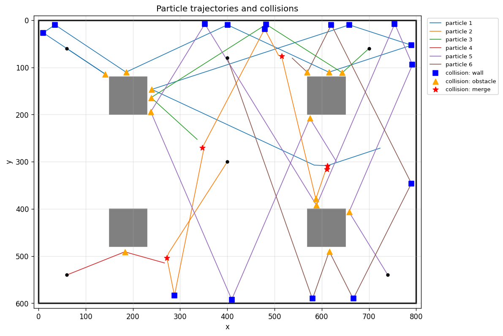
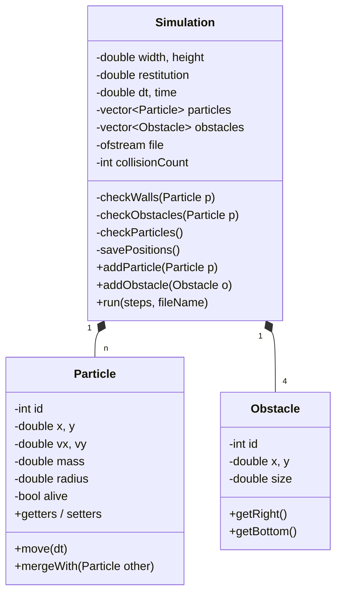

# particle-collision-simulator

Discrete-time simulation of particles colliding in a box with obstacles, in C++. Informatica II, UdeA — Práctica 5, activity 2.1.

## What it does

- A box of 800 x 600 with **4 square obstacles** and **6 particles** (each one with position, velocity, mass and radius).
- Every step (`dt = 0.01 s`) each particle moves with `x = x0 + v*dt` and then the collisions are checked:
  1. **Particle vs wall** — perfectly elastic: the speed that goes into the wall is flipped (`vx = -vx` or `vy = -vy`).
  2. **Particle vs obstacle** — inelastic with `e = 0.7`. The program finds the closest point of the square to the particle to know which side it hit (`left`, `right`, `top`, `bottom` or `corner`). Then `v⊥' = -e·v⊥` and `v∥' = v∥`.
  3. **Particle vs particle** — perfectly inelastic: they become one body.
     - mass: `M = m1 + m2`
     - velocity: `v' = (m1·v1 + m2·v2) / (m1 + m2)` (momentum is conserved)
     - position: the center of mass
     - radius: `sqrt(r1² + r2²)` so the area stays the same

## Output file

`simulation.txt`:

```
B 800 600                         box
O 1 150 120 80                    obstacle: id x y size
P 0.01 1 61.2 60.8 10             position: time id x y radius
C 1.98 wall 3 top 482.2 9          collision with a wall: time particle side x y
C 0.52 obstacle 3 2 top 642.8 111  collision with an obstacle: time particle obstacle side x y
C 1.39 merge 2 4 271.9 503.8 mass 5.5   two particles merged
```

## Plot

```
python plot.py
```

It reads `simulation.txt` and draws the trajectories and every collision (`trajectories.png`).



## Class diagram



## Build

Open `CMakeLists.txt` in Qt Creator and run, or:

```
cmake -S . -B build
cmake --build build
./build/particle_simulation
```
